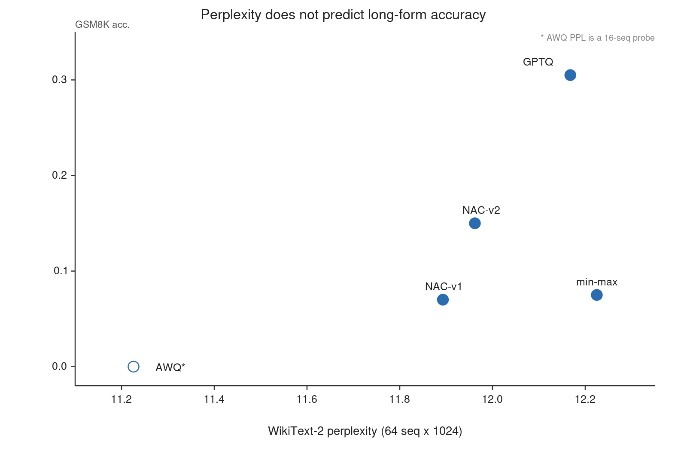
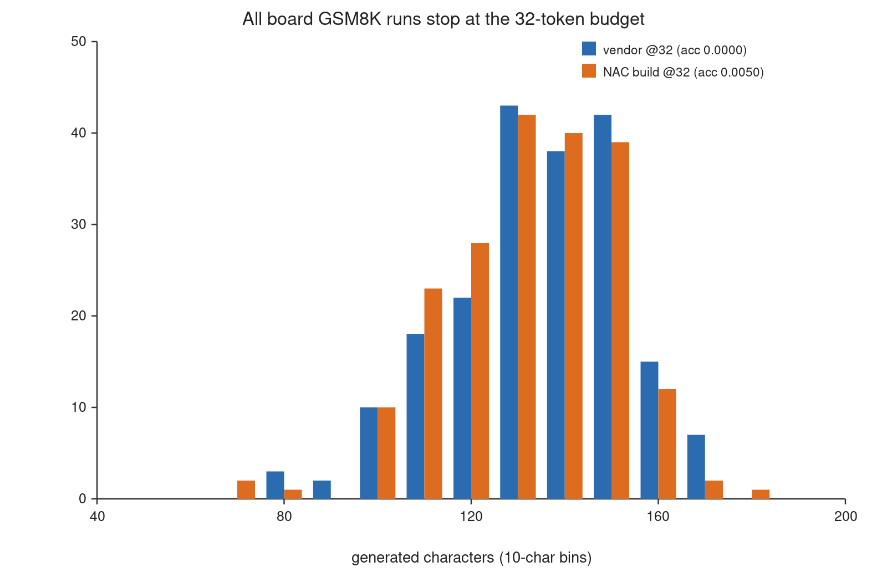
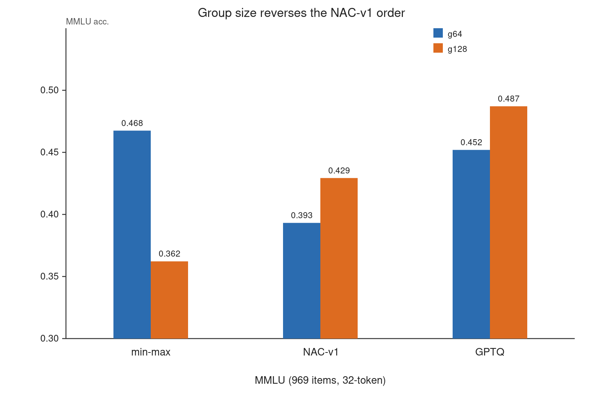
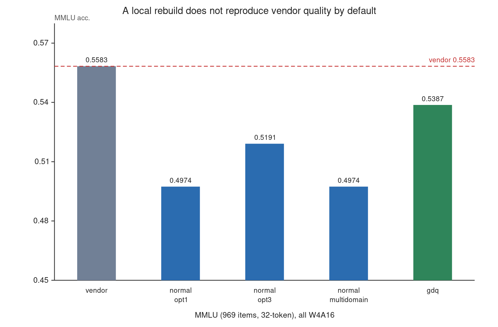

# Calibration Objectives and Evaluation Protocols in 4-bit Edge LLM Deployment

**Title page**

*Calibration Objectives and Evaluation Protocols in 4-bit Edge LLM Deployment*

YIBO ZHANG† a, Muhammad Syafiq bin Mohd Pozi a, Osman B Ghazali a

a Universiti Utara Malaysia, 06010 UUM Sintok, Kedah, Malaysia

† Corresponding author.
E-mail address: zhang_yibo@ahsgs.uum.edu.my (YIBO ZHANG).

---

# Calibration Objectives and Evaluation Protocols in 4-bit Edge LLM Deployment

## Highlights

- Calibration-objective effects on an edge NPU are often *unidentifiable* — the evaluation protocol and build path dominate.
- Under a contamination-free deployment protocol, four quantized objectives are statistically tied on long-form GSM8K.
- A 32-token generation cap drives even the vendor reference model to 0.0000; at 512 tokens it recovers to 0.5550.
- The sign of a calibration effect can reverse with group size (NAC-v1: -7.43 at g64, +6.71 at g128).
- A reproducible harness and protocol-checklist expose the confounds that hide or invert method effects.

## Abstract

Weight-only 4-bit quantization is the default way to deploy large language models on edge NPUs, and the calibration step that precedes deployment is almost always validated in a floating-point simulation rather than on the target device. We study the *identifiability* of calibration-objective effects under one W4A16 pipeline, one 1.5B model and one edge SoC (Rockchip RK3576), across five calibration objectives (min-max, GPTQ, AWQ, NAC-v1, NAC-v2). Under a contamination-free deployment-level protocol the four quantized objectives are statistically indistinguishable on long-form GSM8K arithmetic (all pairwise paired-McNemar p ≥ 0.31), even though they are separated by perplexity and multiple-choice accuracy. Calibration effects are bounded by group size — NAC-v1 loses 7.43 points of MMLU to min-max at g64 and gains 6.71 at g128 — and the sign of an effect can reverse with a hyperparameter that papers rarely ablate. On the deployment stack itself, a 32-token generation cap — the default of common harnesses — drives even the vendor reference model to 0.000–0.015, whereas at 512 tokens the same artifacts score 0.535–0.565 and are statistically indistinguishable from the vendor. Collectively these findings show that on edge NPUs the evaluation protocol and the build path are as consequential as the calibration method itself, so that a method's effect is unidentifiable unless those choices are controlled. We give a reproducible protocol, harness and checklist that make these confounds visible. We make no state-of-the-art claim.

**Keywords**: post-training quantization, edge NPU, W4A16, evaluation protocol, chain-of-thought, calibration

## 1 Introduction

Deploying a 1.5B-parameter language model on a 16 GB edge SoC is routine: quantize the weights to 4 bits, calibrate on a small corpus, export to the vendor runtime. The calibration step is where most published methods compete, and it is evaluated almost universally in simulation [1] — apply the quantizer's `dequant(quantize(W))` to each weight, run the model in fp32, and report perplexity and zero-shot accuracy. The implicit assumption is that simulation is a faithful proxy for deployment.

This paper asks what that assumption costs, and in particular whether a calibration method's *effect* — the quantity that would let a practitioner choose one objective over another — is even identifiable once a deployment-grade protocol is imposed. We do not propose a new quantizer. Instead we hold the deployment stack fixed, vary the calibration objective across five methods (min-max, GPTQ, AWQ, NAC-v1, NAC-v2), and ask which of the differences that simulation reports survive when the metric moves from next-token likelihood to multi-step generation on the actual device. Our answer is that on this stack, most of them do not survive, and that the intervening variables — the evaluation protocol and the build path — are so consequential that a method's apparent advantage can be hidden, or even reversed, without those choices being controlled.

Our study is organised around three axes that are usually conflated (Section 3): the *quantizer* (toolkit-native min-max/GPTQ versus externally calibrated NAC/AWQ), the *execution stack* (x86 fp32 pseudo-quantization versus the RK3576 NPU), and the *evaluation protocol* (task, shots, generation cap, answer extraction). Every table in this paper labels all three. The scientific claim we advance is not "method A beats method B" but a claim about *identifiability*: on a real edge deployment stack, the effect attributable to the calibration objective is not separable from the effects of the protocol and the build path unless all three are fixed and reported.

**Finding 1 (calibration objective).** Under a contamination-free protocol — each generation truncated at the first new question and scored at 512 tokens — the four quantized calibration objectives are statistically indistinguishable on GSM8K accuracy: fp16 leads (0.530, last-number) but min-max (0.410), GPTQ (0.395), NAC-v2 (0.395) and NAC-v1 (0.365) are statistically tied with each other (paired McNemar p = 0.31–0.90 on every pair under last-number, and p = 0.22–0.89 under answer-is; the largest gap is min-max over NAC-v1 at +4.5 pp, p = 0.31). This is not the ranking a perplexity comparison predicts — NAC-v1 has the *best* perplexity of the quantized set (11.893 versus 12.168 and 12.225) yet does not lead on arithmetic. The contrast is therefore: perplexity and long-form accuracy do not rank these methods consistently, but neither is a *reliable* discriminator here, because all four objectives are within statistical noise of each other. On these 200 items the only robust simulation-side effect we can separate from the protocol is fp16 above any of the quantized objectives.

**Finding 2 (protocol).** The same measurements are extremely sensitive to how generation is scored. With a 32-token cap — the default of the evaluation harness and of several published edge-deployment recipes — the vendor's own W4A16 model scores 0.0000 on GSM8K, and ten locally built variants score 0.000–0.015. Extending the cap to 512 tokens restores the vendor model to 0.5550, and restores one of those local artifacts from 0.0150 to 0.5350 (statistically tied with the vendor, p = 0.69): the "long-form failure" was the cap. Second, once the generation is truncated at the next question, the choice between extracting the last number and the first "answer is" number moves each configuration by at most a few points (answer-is raises GPTQ and NAC-v1 by 8.0 pp, NAC-v2 by 5.0 pp, min-max by 1.0 pp) and never changes which objectives are statistically separable. An earlier apparent 4× spread between GPTQ and min-max/NAC-v1 (0.305 versus 0.075/0.070) was an artefact of scoring the continuation: it does not survive the stop-rule truncation of Section 6.2.2. The honest statement is that on these data the protocol, not the calibration objective, is what separates the measurements.

**Finding 3 (boundary).** Calibration effects are conditional on group size. At g64, NAC-v1 loses 7.43 points of MMLU to min-max (p = 3.3e-9); at g128 it *wins* by 6.71 points (p = 7.9e-9). The sign of the effect, not just its size, depends on a hyperparameter that papers rarely ablate.

**Finding 4 (build path).** On the NPU, where single-letter MMLU is insensitive to the cap, a local rebuild of the same model with the toolkit's default algorithm scores 0.4974 against the vendor artifact's 0.5583 (−6.09 pp, p = 3.0e-4). Switching the build algorithm to `gdq` closes the gap to a statistical tie (0.5387, p = 0.18). The vendor's algorithm is not documented, so "rebuild and compare" is not a controlled experiment unless the algorithm is fixed.

**Contributions.** Whereas prior work reports method-level differences from floating-point simulation, our contribution is a controlled account of when those differences are *identifiable* on a real deployment stack:
1. A three-axis evaluation protocol with a reproducible harness that archives full generations, token counts, and termination flags (Section 3, Appendix B).
2. A controlled comparison of five calibration objectives under one W4A16 pipeline, showing that four quantized objectives that are separated by perplexity and multiple-choice accuracy are statistically indistinguishable on long-form arithmetic (Section 6.1).
3. A quantified account of two protocol artefacts — the generation cap and the extraction rule — that are large enough to reverse published conclusions (Section 6.2), with the vendor model as the control.
4. A boundary characterisation of calibration effects along group size and task type (Section 6.3).
5. A build-reproducibility result: the same model rebuilt with the toolkit's default algorithm loses 6.1 points of MMLU to the vendor artifact, and only a different quantization algorithm closes the gap (Section 6.5).
6. A protocol checklist for edge quantization papers, in which every item corresponds to a measured failure in this study rather than to intuition (Section 7.1).

We do **not** claim state of the art, that one calibration family dominates, or that any of these effects transfer to other SoCs without replication.

## 2 Related Work

**Post-training quantization.** Weight-only quantization is the standard way to make LLMs fit on edge devices, and post-training quantization (PTQ) is its lightest-weight route because it needs neither re-training nor labelled data [2]. Among the objectives we compare, GPTQ [3] minimises layer-wise reconstruction error with a Hessian-based update in column order. AWQ [4] searches per-channel scales that protect salient activation channels and folds them into adjacent weights. SmoothQuant [5] migrates activation outliers into weights, and ZeroQuant [6] combines group-wise weight quantization with layer-wise distillation. OmniQuant [7] learns clipping and transformation parameters, and rotation-based methods such as QuaRot [8] remove outliers before quantization. Outside the reconstruction-objective family, sparse-and-additive schemes [9, 10] and calibration-free quantization [11] trade accuracy differently, and low-bit training data types [12] and non-uniform dense-&-sparse decomposition [13] further widen the deployment trade-off surface. All of these optimise a *simulated* objective, and all are evaluated primarily by perplexity plus zero-shot accuracy on classification-style tasks; the scaling behaviour of k-bit inference is itself the subject of [14].

**Evaluation validity.** The observation that accuracy is insufficient to characterise compressed models is not new — [15] makes the general case for compression. What is missing is a *deployment-side* account: which protocol choices move the number, by how much, and in which direction. Our §6.2 is an attempt at that accounting on a concrete NPU.

**Edge NPU deployment.** Running LLMs on edge devices has become an active research area of its own [16], and vendor toolchains (rknn-llm, MNN, ExecuTorch, TFLite) expose integer-domain quantization parameters and their runtimes implement integer dequantization [17, 18]. Public documentation of the exact asymmetry semantics is thin, and recent work on Ascend NPUs [19] reports that PTQ baselines behave differently on-device than in simulation. Our study is complementary: it fixes one SoC and one model and asks how much of the simulation-deployment gap is attributable to calibration versus measurement.

**Positioning.** This is a measurement paper about the *identifiability* of method effects under deployment-grade evaluation. Its unit of contribution is a *reproducible discrimination* — a protocol under which two calibration objectives can be told apart — plus the boundary conditions under which that discrimination holds, and the demonstration that without these controls the apparent ranking of calibration methods is unidentifiable.

## 3 Evaluation Framework

### 3.1 Three axes

| Axis | Levels | Why it must be labelled |
|---|---|---|
| Quantizer | toolkit-native (min-max, GPTQ) / externally calibrated (NAC-v1, NAC-v2, AWQ) | The calibration corpus and the numerical path differ |
| Stack | x86 fp32 pseudo-quantization / RK3576 NPU | Absolute numbers are not comparable across stacks |
| Protocol | task × shots × generation cap × extraction rule | Changes the ranking (Section 6.2) |

**Rule.** No table mixes levels of the stack axis; no claim crosses the stack axis without an explicit "not comparable in absolute terms" caveat.

### 3.2 Deployment-level protocol

Hardware: NanoPi M5 (RK3576), 4×Cortex-A53 @2.016 GHz + 4×Cortex-A72 @2.208 GHz, 16 GB LPDDR5, 2-core NPU @950 MHz, fixed-frequency operation (CPU/NPU/DDR) for all timed runs. Runtime: librkllm 1.2.3.

Models: Qwen2.5-1.5B-Instruct [20] (full matrix) and Qwen2.5-3B-Instruct (vendor-quantized reference point only).

Tasks: MMLU [21] (969 items, zero-shot, 32-token cap, single-letter answer), GSM8K [22] (200 items, zero-shot for deployment and 2-shot CoT [23] for simulation, 512-token cap), WikiText-2 [24] held-out perplexity (64 sequences × 1024 tokens).

### 3.3 What we archive

For every item we store the full generation (up to 4000 characters), the token count, whether the cap was hit, and *both* extraction results (last number and first "answer is"). This is a direct response to the failure mode described in §6.2: an accuracy scalar computed from an unarchived generation cannot be audited, and cannot be re-scored under a different rule.

## 4 Calibration Objectives

All methods produce per-group `(scale, zero_point)` for the deployment kernel's dequantization `W' = scale_g · (q − zp_g)`, `q ∈ [0,15]`, group size 64 or 128.

**Min-max (toolkit `normal`).** Per-group extremes; no error compensation. Represents the "no calibration objective" baseline.

**GPTQ.** Hessian-based column-order compensation with `percdamp = 0.01` and a max-shrink grid (0.8, 100 points); integer zero-points; 6527 s calibration on the board's CPU.

**AWQ (re-implementation).** Activation-aware per-channel scale search (α grid, 21 points, step 0.05), clip grid, exact folding into adjacent weights, integer zero-points; 1511 s. Fold correctness is asserted separately: a fold-only pass reproduces fp16 perplexity exactly (10.627), which bounds implementation error before any accuracy claim.

**NAC-v1.** GPTQ-style sequential block propagation plus an activation-weighted per-group truncation-ratio grid (κ ∈ {1.0, 0.95, …, 0.4}) minimising `Σ_g a ⊙ (W − dequant(q(W; κ)))²`; floating-point zero-points; 521 s — the cheapest method in the study.

**NAC-v2.** NAC-v1 plus integer zero-points and block-wise Hessian compensation (`act_weight = diag(H)`, `percdamp = 0.01`); 4259 s.

**On attribution.** NAC-v2 changes two things at once (zero-point rounding and Hessian compensation). In simulation, integer zero-points change only rounding, so the simulated gain is attributable to the Hessian term; this is a prediction, not a measured decomposition, and we do not report a per-component split.

## 5 Experimental Setup

**Calibration.** All objectives use the same calibration corpus: 128 WikiText-2 sequences of 512 tokens, of which 8 sequences (4096 tokens) are used for activation statistics and Hessian accumulation; seed 42; float32 on CPU. NAC's κ grid is {1.0, 0.95, 0.9, 0.85, 0.8, 0.7, 0.6, 0.5, 0.4}, searched per group. GPTQ and NAC-v2 use `percdamp = 0.01` and the same column ordering.

**Simulation.** `apply_qparams` replaces each linear weight by `dequant(quantize(W))` layer by layer with float32 arithmetic, using the same `scale·(q − zp)` formula as the kernel and the same group size. No activation quantization is applied (W4A16). Generation is greedy (`top_k = 1`), with `keep_history = 0` so items are independent.

**Deployment.** RKLLM runtime 1.2.3, context 4096, embedding cache enabled (`embed_flash = 1`), 4×A72 cores enabled. All timed runs use fixed frequencies (CPU 2016/2208 MHz, NPU 950 MHz, DDR 2736 MHz) verified before each run. Model dtype and artifact md5 are recorded for every run.

**Perplexity.** WikiText-2 held-out, 64 sequences × 1024 tokens for all configurations except AWQ's probe (16 sequences), labelled wherever it appears.

**Statistics.** McNemar's test with continuity correction for paired binary outcomes [25]; bootstrap 95% confidence intervals over items; tie criterion p > 0.05 together with a difference smaller than the CI width. Pairing is by item index, verified by asserting that the gold-answer sequence is identical between the two runs. Full pairwise statistics, including odds ratios, are in Appendix C. `analysis/check_claims.py` re-derives every number in this paper from the archived JSON and fails if any of them drifts.

## 6 Results

### 6.1 Calibration objective: likelihood and multiple-choice invert long-form ranking

**Table 1.** Simulated calibration objectives, one model (Qwen2.5-1.5B), one dtype (W4A16), group size 64.

| Method | MMLU (969) | GSM8K (200) | PPL (64 seq) | Calib. time |
|---|---|---|---|---|
| fp16 | 0.4634 | **0.530** | 11.075 | — |
| min-max | 0.4675 | 0.410 | 12.225 | — |
| GPTQ | 0.4520 | 0.395 | 12.168 | 6527 s |
| AWQ | 0.4396 | — (n=64) | 11.226¹ | 1511 s |
| NAC-v1 | 0.3932 | 0.365 | **11.893** | 521 s |
| NAC-v2 | 0.4469 | 0.395 | 11.962 | 4259 s |

¹ 16-sequence probe; all other perplexities are 64-sequence. GSM8K = last-number accuracy under the contamination-free 512-token protocol of Section 6.2 (stop at the first `\nQuestion:`); AWQ lacks a full 200-item re-measurement and is shown only as a perplexity outlier at n=64.

Two orderings coexist in this table. By perplexity, NAC-v1 is best among the quantized methods and GPTQ is worst; by GSM8K under the contamination-free protocol, the four quantized methods are statistically tied (Figure 1). MMLU discriminates more finely than GSM8K does: two further pairwise effects are significant at the 5% level — AWQ is 2.79 points below min-max (p = 0.033) and 2.37 points below fp16 (p = 0.038) — in addition to NAC-v1's 7.43-point deficit to min-max (p = 3.3e-9), while the remaining MMLU pairs are statistical ties. Close to the 5% threshold and after multiple comparisons, these two effects are weak evidence rather than a robust finding. The deployment-side MMLU comparison (Section 6.5) shows only a build-path effect, not a calibration effect.

**Figure 1.** Perplexity versus GSM8K accuracy for the five calibration objectives. Perplexity is widely spread (NAC-v1 best) while the four quantized objectives are statistically tied under the contamination-free GSM8K protocol (Section 6.1); fp16 sits clearly above all of them on arithmetic while having the best perplexity at 11.075. AWQ's perplexity is a 16-sequence probe (open marker).

**The apparent 4× was an extraction/continuation artefact.** An earlier version of this work scored each generation's *last number* without truncating the generation, which reads arithmetic results out of any continuation into a following question. Under that protocol GPTQ appeared 4× better than min-max and NAC-v1 (0.305 versus 0.075/0.070). Re-scoring the same generations on the answer sentence compressed the gap to ~1.3×, and both numbers were contaminated by continuation. The re-run of Section 6.2.2 truncates each generation at the first `\nQuestion:` and archives full generation text, so the two effects can be separated exactly rather than boundedly:

| Method | last-number (stored) | answer-is (prefix recompute) |
|---|---|---|
| fp16 | 0.530 | 0.540 |
| min-max | 0.410 | 0.420 |
| GPTQ | 0.395 | 0.475 |
| NAC-v2 | 0.395 | 0.445 |
| NAC-v1 | 0.365 | 0.445 |

Under the full-archive protocol the last-number and answer-is extractors agree (within the 8 pp shown), the apparent 4× gap collapses to a few points, and no pair of quantized objectives is statistically separable on either rule (paired McNemar p ≥ 0.31 under last-number, p ≥ 0.22 under answer-is). The activation-weighted methods (NAC-v1, NAC-v2, min-max) also continue into a next question more often than GPTQ when *not* stopped (NAC-v1 30%, NAC-v2 37%, min-max 38%, AWQ 53%, versus 11% for GPTQ) — a real behavioural difference about the termination policy (Section 6.4) — but under a last-number metric scored on the full generation that difference becomes an apparent accuracy gap. The honest statement is therefore: **calibration objectives differ in whether the model stops after answering, and a last-number metric over untruncated generations converts that termination difference into an apparent accuracy gap that does not survive a contamination-free protocol.**

The pattern is not a single-method accident. AWQ — an independent activation-weighted family with a different parameterisation — matches the same termination signature: best-in-class perplexity among the methods we could measure at 16 sequences (11.226), MMLU statistically tied with GPTQ and NAC-v2 (p = 0.369 and 0.579), and a termination signature (generations that on this harness often do not stop after answering; Section 6.4). Its GSM8K score was measured only at n = 64 under the earlier untruncated protocol, so it is not part of the 200-item contamination-free comparison; the re-measurement needed to place it in Table 1 was not completed for this submission. We therefore report AWQ's perplexity and MMLU, and its termination behaviour, but not a GSM8K accuracy number.

**Interpretation.** Likelihood averages over token positions and is dominated by high-probability continuations; it is insensitive to the low-probability tail where EOS lives and where multi-step arithmetic errors accumulate. A possible mechanism — consistent with our observations but not independently confirmed here — is that a calibration objective which minimises reconstruction error can improve perplexity while changing the model's tendency to terminate a generation.

### 6.2 Protocol artefacts

#### 6.2.1 The generation cap

The strongest evidence that the cap, not the model, can determine the score comes from a within-model manipulation. We evaluated the *vendor-provided* W4A16 model — the reference artifact, untouched by any of our calibration code — on the same 200 GSM8K items, changing only `max_new_tokens`:

| Model | max_new_tokens | GSM8K | median generation length |
|---|---|---|---|
| vendor W4A16 | 32 | **0.0000** | 140 chars |
| vendor W4A16 | 512 | **0.5550** | >200 chars (archive capped) |

At 32 tokens the reference model scores zero. Its generations are not degenerate: they begin with a correct restatement of the problem and a correct first step, and stop mid-number — for the first item, `"…divide by 3.\n\nThe first measurement is 47 W"`. The harness's last-number extractor reads `47` and marks the item wrong. A second vendor model (Qwen2.5-3B, same harness, 512 tokens) scores 0.6700, so the harness is not degenerate by construction: it is the cap that is.

The same manipulation applies to a locally rebuilt artifact, and it is the clearest single result in this paper:

| Artifact | GSM8K @32 tok | GSM8K @512 tok |
|---|---|---|
| vendor W4A16 | 0.0000 | 0.5550 |
| local rebuild (`normal`, opt=1, W4A16) | 0.0150 | **0.5350** |
| local group-quantized build (`W4A16_G64`, the artifact an earlier version of this work labelled a calibration collapse) | 0.0050 | **0.5650** |
| second group-quantized build (alternate calibration, `W4A16_G64`) | 0.0050 | **0.5600** |

Nothing about these models changes between the two columns except the cap. At 512 tokens all three are statistically indistinguishable from the vendor artifact (paired McNemar: p = 0.69, 0.88 and 1.00 respectively), and the 52–56-point differences within each row are artefacts of the harness. A conclusion of the form "the local build loses long-form reasoning" cannot be drawn from a 32-token run: the data do not support it, and it is an artefact of the cap rather than of the model.

The 512-token protocol is also clean on its own terms: across the three artifacts re-measured with the instrumented harness, the cap was hit in only 1.5–2.0% of items (median generation 235–248 tokens), and no generation opened a new question after its answer (cross-question rate 0.00). Under 32 tokens, the same artifacts hit the cap in essentially every item and never reach an answer sentence (Table 2).

For the third row the point is sharper. That artifact was, in an earlier version of this work, the central evidence for a hardware-semantics hypothesis: it scored 0.0050 at 32 tokens and was read as numerical corruption. At 512 tokens it scores 0.5650 — above the vendor's 0.5550, with identical last-number and answer-anchored scores (0.5650/0.5650), i.e. no continuation contamination at all. A second, independently calibrated artifact behaves the same way (0.0050 → 0.5600). The "collapse" was the cap.

The same signature appears in every locally built variant we evaluated at 32 tokens (Table 2, Figure 2): median length 129–147 characters, 90th percentile ≤161, no generation reaches a concluding sentence, and the distribution of final characters is dominated by digits and operators. Under a 512-token cap the vendor model reaches 0.5550. We therefore treat all 32-token numbers in our own earlier records — and any published edge-deployment number produced with a similar default — as measuring the cap.

**Figure 2.** Length distribution of GSM8K generations under a 32-token cap, vendor model versus one locally built variant. Both distributions terminate against the same budget; neither reaches a concluding answer sentence.

**Table 2.** Truncation signature of GSM8K runs. `tail-mid` is the fraction of generations whose last character is a digit or operator; `hasAns` is the fraction containing a concluding "answer is".

| Run (all 32-token unless noted) | n | GSM8K | p50 len | p90 len | tail-mid | hasAns |
|---|---|---|---|---|---|---|
| vendor | 200 | 0.0000 | 140 | 160 | 0.32 | 0.00 |
| min-max (toolkit) | 200 | 0.0050 | 147 | 161 | 0.32 | 0.00 |
| NAC-v1 calibration artifact | 200 | 0.0050 | 138 | 158 | 0.28 | 0.00 |
| NAC-v2 calibration artifact | 200 | 0.0050 | 138 | 158 | 0.28 | 0.00 |
| local x86 build, alg=normal | 200 | 0.0150 | 138 | 157 | 0.38 | 0.00 |
| local x86 build, alg=gdq | 200 | 0.0100 | 145 | 161 | 0.28 | 0.00 |
| vendor, 512-token | 200 | **0.5550** | 200* | 200* | 0.23 | 0.00¹ |

\* archive capped at 200 characters; the scoring used full text.
¹ "answer is" appears only after the first 200 characters, which is why archived prefixes cannot be re-scored (Section 6.2.2).

This is a measurement-validity problem rather than a modelling result, and it has a simple control: **run the reference model under the same harness**. If the reference scores near zero, the harness is the treatment.

#### 6.2.2 The extraction rule

Re-scoring full-archive generations with the "answer is" rule raises every configuration: fp16 0.530→0.540, GPTQ 0.395→0.475, min-max 0.410→0.420, NAC-v1 0.365→0.445, NAC-v2 0.395→0.445 (AWQ lacks a full 200-item run). These are exact numbers on the truncated generation, not lower bounds. The key fact is that under either rule no pair of quantized objectives is statistically separable (paired McNemar p ≥ 0.31 under last-number, p ≥ 0.22 under answer-is), whereas fp16 stays clearly above all of them on last-number (p ≤ 0.003). The earlier claim of a 4.1×→1.3× GPTQ margin over NAC-v1 was an artefact of scoring untruncated generations; it does not survive the contamination-free protocol.

A termination signal is visible in AWQ's case. Under the earlier untruncated protocol (n = 64), a large fraction of its generations did not emit EOS and continued into a new question, so a last-number metric read arithmetic results out of the continuation. Whether this is an accuracy failure or a termination failure cannot be separated at n = 64 without the contamination-free re-measurement, so we do not make that call for AWQ here; the same mechanism was confirmed exactly for the other activation-weighted methods (NAC-v1, NAC-v2, min-max) at n = 200 (Section 6.4).

We therefore report both rules and treat any conclusion that flips between them as protocol-dependent rather than method-dependent. The re-run additionally truncates each generation at the first `\nQuestion:` before scoring (the installed transformers version does not support generation-time stop strings, so the truncation is applied to the decoded text), which removes the continuation component and lets arithmetic quality and termination behaviour be measured separately rather than as a product.

### 6.3 Group size reverses the sign

**Table 3.** The same three objectives at group size 128 (MMLU, 969 items; 64-sequence perplexity).

| g128 | MMLU (969) | PPL (64 seq) |
|---|---|---|
| min-max | 0.3622 | 12.544 |
| NAC-v1 | **0.4293** (+6.71 pp, p = 7.9e-9) | **12.164** |
| GPTQ | 0.4871 | 12.503 |

The NAC-v1 deficit at g64 (−7.43 pp) becomes a gain at g128 (+6.71 pp). The effect is not a monotone function of "finer grouping is better": g128 is coarser, and the coarser setting favours the truncation-grid objective while the finer setting favours Hessian compensation (Figure 3). Any claim of the form "method X beats method Y" must therefore carry its group size.

**Figure 3.** MMLU accuracy at group size 64 versus 128. The ordering of the three calibration objectives is not preserved; NAC-v1 moves from last to second, and min-max moves from first to last.

### 6.4 Termination behaviour as a first-class metric

A last-number score conflates three failure modes: the model computes the wrong answer, the model does not answer, and the model answers but does not stop. Only the first is a calibration-quality signal. Our archives expose the third. As a coarse first cut, the fraction of untruncated generations that contain a `Question:` token at character position ≥120 (i.e. that already ran into a following-answer block) is 11% for GPTQ, 30% for NAC-v1, 37% for NAC-v2, 38% for min-max and 53% for AWQ (`analysis/crossq.py`). A stricter audit that requires the new `Question:` to appear *after* the generation's final `answer is` sentence yields the same ordering with larger separations (GPTQ 12%, NAC-v1 39%, NAC-v2 46%, min-max 60%, AWQ 62%): GPTQ continues the least and the activation-weighted methods continue the most. Under the truncated protocol of Section 6.2.1 the continuation is removed at the source, and the same generations show `Question:` in 0–4% of cases, so the effect is a termination behaviour, not a computation error. These numbers are exactly what explain the apparent ranking in the earlier, untruncated protocol: methods that continue more often (NAC-v1, NAC-v2, min-max, AWQ) scored worse than GPTQ when the metric read a number out of the continuation, and their relative order collapsed once that continuation was removed (Section 6.2.2).

This is not an argument that the continuation behaviour is harmless. In deployment, a model that answers correctly and then continues into a hallucinated next question is a real failure — it wastes decode budget and can corrupt downstream parsing. It is an argument that the failure must be *reported as termination*, with an EOS rate or a stop-sequence rule, rather than folded into an accuracy number. The re-run (Section 6.2.1) records token counts and cap hits per item, which makes this separation exact rather than prefix-bounded.

### 6.5 Deployment: the build path is a variable

MMLU is answered with a single letter and is therefore insensitive to the generation cap (Section 6.2), so it can serve as a clean deployment-side probe. Fixing the model, the toolkit version (1.2.3) and the quantization dtype (`W4A16`), we rebuilt locally and varied only the build algorithm:

**Table 4.** Deployment-side MMLU for the same model and dtype, rebuilt with different toolkit settings.

| Build | Algorithm | MMLU (969) | vs vendor | b/c · p |
|---|---|---|---|---|
| vendor | not disclosed | 0.5583 | — | — |
| local, opt=1 | `normal` | 0.4974 | −6.09 pp | 158/99 · 3.0e-4 |
| local, opt=3 | `normal` | 0.5191 | −3.92 pp | 132/94 · 0.014 |
| local, opt=1, multi-domain calibration | `normal` | 0.4974 | −6.09 pp | 150/91 · 1.9e-4 |
| local, opt=1 | `gdq` | 0.5387 | −1.96 pp | 98/79 · 0.18 (tie) |

Two readings. First, a local rebuild with the default algorithm is 6.1 points worse than the vendor artifact — significant, and reproduced across two independent builds with different calibration sets (both 0.4974; p = 3.0e-4 and 1.9e-4). Raising the optimization level recovers about a third of the gap (0.5191, p = 0.014). Second, the gap is statistically closed by a different quantization algorithm (`gdq`), which the vendor does not document. "Vendor quality" is therefore not reproducible from the documented default pipeline: the algorithm is a hidden variable, and any study that compares calibration methods on top of a locally rebuilt baseline inherits that uncertainty.

The loss is task-specific, and we report it as such: at 512 tokens the same local build is statistically tied with the vendor on GSM8K (0.5350 vs 0.5550, p = 0.69). The build-path difference therefore shows up on the knowledge-oriented multiple-choice task and not on the arithmetic task, which rules out a generic "the local build is worse" explanation and makes the mechanism an open question (Section 8).

**Figure 4.** Deployment-side MMLU for the same model and dtype, rebuilt with different toolkit settings. The dashed line is the vendor artifact. Only the `gdq` build recovers it within statistical noise.

The group-quantized artifacts (`W4A16_G64`) are excluded from this table: they differ in dtype, and their apparent advantage over the plain build (+6.40 pp, p=2.8e-5) confounds granularity with build path. We state this explicitly because an earlier version of this work compared them as if they were the same configuration.

We report deployment-side GSM8K only where the 512-token protocol has completed. Both measured artifacts are statistically indistinguishable from the vendor (0.5550): the plain rebuild at 0.5350 (p = 0.69) and the group-quantized build at 0.5650 (p = 0.88). A fourth deployment artifact — a group-quantized 4-bit build (`W4A16`/g64) produced by the toolkit's own GRQ build path (the vendor toolchain's default quantizer rather than an externally calibrated objective) — scores 0.525 on the same 200 items (0.5250/0.5250, identical under both extractors); its paired comparison against the vendor was not part of this audit and we only report the point score. We do not report 32-token numbers, because those measure the cap (Section 6.2.1).

## 7 Discussion

**Why likelihood misleads.** Perplexity is a mean over positions of log p(token | prefix). Two failure modes are invisible to it: a shift in the EOS decision (a single low-probability event at the end of a long generation) and error accumulation in multi-step arithmetic (errors appear late, after many correct tokens). Both are precisely what edge deployment cares about.

**Why the cap matters more than the method.** A 32-token cap truncates a chain of thought before its answer in essentially every GSM8K item. The resulting score measures the cap, not the model. Because the cap is a harness default, this failure mode is likely to be widespread; the control that exposes it is the vendor model, which must score well under the same harness if the harness is valid.

**Implications for toolchains.** If a runtime's dequantization semantics differ from the calibration-side semantics, the difference is invisible in simulation and appears as a deployment-only degradation. Our data cannot yet distinguish such a semantic gap from build-path effects; we report the controlled comparison we can defend and mark the rest as open (Section 8).

### 7.1 A protocol checklist

Each item below is a mistake we made, found, and fixed. They are cheap to check and each one is capable of reversing a conclusion.

| # | Requirement | Failure it prevents | Our case |
|---|---|---|---|
| 1 | Report the generation cap; set it from the task, not from the harness default | A cap that truncates reasoning scores the cap | 32-token cap zeroed the reference model |
| 2 | Run the reference model under the same harness before trusting any comparison | A broken harness looks like a broken method | vendor 0.0000 at 32 tokens |
| 3 | Enforce or report a stop rule (`\nQuestion:`, EOS rate) | Continuation is scored as an arithmetic error | 11–53% cross-question continuation |
| 4 | Report two extraction rules, or one anchored on the answer sentence | Last-number extraction reads numbers out of the continuation | a few pp, no rank change (Section 6.2.2) |
| 5 | Archive full generations and token counts, not prefixes | No item-level audit is possible; re-scoring is impossible | 200/300-character archives |
| 6 | Label the quantization dtype of every arm (per-channel vs group size) | Calibration effects confound with granularity | `W4A16` vs `W4A16_G64` |
| 7 | Verify that the treatment artifact differs from the control (md5) | A silently ignored treatment yields a null result | three "different" builds, one md5 |
| 8 | Report the group size with every ranking claim | The sign of the effect can flip | g64 −7.43 pp, g128 +6.71 pp |

We do not claim this list is complete, but every entry is backed by a measured failure in this study rather than by intuition.

## 8 Limitations

1. **Single platform, single model family.** One SoC and one 1.5B model; the 3B model is a vendor-quantized reference without calibration variants. External validity is unproven.
2. **Board-level externally-calibrated variants are not measured.** The externally calibrated NAC artifacts were produced through a toolchain path whose parameter injection we have not yet demonstrated to take effect at 1.5B scale; moreover those artifacts were built at group size 64 (`W4A16_G64`) while the vendor reference and our local rebuilds are per-channel (`W4A16`), so a board-level NAC-versus-vendor comparison would confound calibration with granularity. We therefore do not report board-side NAC numbers. What we do report on the deployment stack is the GRQ-path build (a group-quantized 4-bit artifact from the vendor toolchain's own default quantizer): GSM8K 0.525 at 512 tokens (Section 6.5), which is consistent with the sim result that the quantized objectives under this protocol do not separate from the vendor.
3. **Simulation is not deployment.** The x86 fp32 stack differs from the NPU in batch handling, prompt formatting, and numerical path; we use it only for paired relative comparisons and never for absolute prediction.
4. **Extraction sensitivity is bounded by archived prefixes.** Historical generations were archived truncated (300/200 characters), so re-scoring gives lower bounds only; the re-run archives full text.
5. **No energy measurement.** The board exposes voltage but not current; we report TTFT and decode throughput only.
6. **NAC-v2's two changes are not separated in simulation.**

## 9 Conclusion

Under one W4A16 pipeline on one edge SoC, we find that the four quantized calibration objectives we compared, though separated by perplexity and multiple-choice accuracy, are statistically indistinguishable on long-form arithmetic once a contamination-free deployment protocol removes the continuation; that this fact is invisible under a 32-token generation cap, which zeroes out even the vendor reference; and that the sign of the remaining calibration effect depends on group size, so that a method that is better at g64 can be worse at g128. The same artifacts score 0.0150 or 0.5350, and 0.0050 or 0.5650, depending only on how many tokens the harness allows, and at the proper cap both are statistically indistinguishable from the vendor model. The lesson is therefore one of *identifiability*: for edge LLM quantization, the evaluation protocol and the build path are part of the result, and an apparent calibration advantage must be re-tested under a controlled protocol before it is reported as a method effect. We release the harness, the archived generations, and a protocol checklist that make these distinctions reproducible.

## Declaration of Competing Interests

The authors declare that they have no known competing financial interests or personal relationships that could have appeared to influence the work reported in this paper.

## CRediT authorship contribution statement

**YIBO ZHANG**: Conceptualization, Methodology, Software, Writing – original draft, Writing – review & editing, Visualization. Corresponding author, responsible for the full content of the manuscript.

**Muhammad Syafiq bin Mohd Pozi**: Supervision.

**Osman B Ghazali**: Supervision.

## Declaration of Generative AI and AI-assisted technologies in the writing process

During the preparation of this work the authors used AI-assisted tooling to assist with the writing and with the statistical analysis. After using these tools, the authors reviewed and verified all experimental results, data, and numbers themselves, and take full responsibility for the content of the publication.

## Data availability

The data and scripts required to reproduce all results and figures in this paper are included with the manuscript as versioned artifacts; the reproducible package (corresponding to Appendix B) documents every artifact with its md5, dtype, and role, together with per-table commands and an explicit list of gaps. Code and data are available at: [https://github.com/BRAD-cording/NAC](https://github.com/BRAD-cording/NAC)

## Acknowledgements

None declared. This research received no specific funding.

## Appendix A — Claims ledger

| Claim | Evidence file | Status |
|---|---|---|
| GSM8K truncated-protocol (last-number): fp16 0.530 / min-max 0.410 / GPTQ 0.395 / NAC-v1 0.365 / NAC-v2 0.395 (n=200 each) | `acc_gsm8k_sim_g64_stop_{fp16,minmax,gptq,nac,nacv2}.json` + records | verified |
| GSM8K truncated-protocol (answer-is): fp16 0.540 / min-max 0.420 / GPTQ 0.475 / NAC-v1 0.445 / NAC-v2 0.445 | same files, `ok_answeris` | verified |
| Pairwise McNemar: four quantized objectives all tied (p ≥ 0.22); fp16 above all (p ≤ 0.003) | `analysis/q1_matrix.py` output | verified |
| PPL @g64 (64 seq): fp16 11.075 / NAC-v1 11.893 / NAC-v2 11.962 / GPTQ 12.168 / min-max 12.225 | `ppl_g64_64seq.json`, `ppl_g64_64seq_nacv2.json` | verified |
| AWQ GSM8K measured at n=64 under untruncated protocol (0 last-number); no contamination-free re-measurement | `acc_gsm8k_sim_g64_awq.json` + records | verified (n=64 only) |
| MMLU p-values (NAC vs min-max, etc.) | `stats_pairs.json` | verified |
| g128 inversion (+6.71 pp, p=7.9e-9) | `acc_mmlu_sim_g128.full.json`, `stats_pairs.json` | verified |
| Vendor 0.0000 @32 vs 0.5550 @512 | `acc_gsm8k_..._zs32.json`, `..._zs.json` | verified |
| Local rebuild 0.0150 @32 vs 0.5350 @512 (p = 0.69 vs vendor) | `acc_gsm8k_qwen1.5b_w4a16plain_x86_zs512.json` | verified |
| Group-quantized artifact 0.0050 @32 vs 0.5650 @512 (p = 0.88; answer-is identical) | `acc_gsm8k_q1bd8_zs512.json` | verified |
| GRQ-path group-quantized build, 512-token deployment GSM8K 0.525/0.525 | `acc_gsm8k_qwen1.5b_r4e_zs.json` | verified |
| Deployment MMLU build-path deltas and p-values | `acc_mmlu_*_zs.records.json`, `stats_pairs.json` | verified |
| fp16 GSM8K anchor 0.530 (last-number) | `acc_gsm8k_sim_g64_stop_fp16.json` | verified |

## Appendix B — Reproducibility package

- `src/eval/accuracy.py`: deployment harness (full-generation archive, token counts, dual extraction).
- `scripts/eval_gsm8k_sim.py`: simulation harness with the same protocol.
- `scripts/q1_board512_queue.sh`: the 512-token re-measurement queue.
- `results/env_snapshot.json`: software versions and artifact md5s.
- `reproduce/MANIFEST.md`: every artifact with md5, dtype and role.
- `reproduce/README.md`: per-table commands and an explicit list of gaps.
- `analysis/`: independent re-scoring scripts used for the audit in this paper.

## Appendix C — Pairwise comparisons

McNemar's test with continuity correction on paired items; `OR = b/c` where `b` counts items the first configuration gets right and the second gets wrong. Differences and CIs are in percentage points; positive means the second configuration is better.

**Table 5.** Pairwise comparisons.

| Comparison | n | acc(A) | acc(B) | Δ (pp) | OR | 95% CI (pp) | p |
|---|---|---|---|---|---|---|---|
| MMLU g64: NAC-v1 vs NAC-v2 | 969 | 0.393 | 0.447 | +5.37 | 2.13 | [+3.0, +7.7] | 2.1e-5 |
| MMLU g64: GPTQ vs NAC-v2 | 969 | 0.452 | 0.447 | −0.52 | 0.92 | [−2.8, +1.7] | 0.72 |
| MMLU g64: min-max vs NAC-v2 | 969 | 0.468 | 0.447 | −2.06 | 0.75 | [−4.4, +0.3] | 0.11 |
| MMLU g64: fp16 vs NAC-v2 | 969 | 0.463 | 0.447 | −1.65 | 0.72 | [−3.7, +0.4] | 0.13 |
| MMLU g64: GPTQ vs AWQ | 969 | 0.452 | 0.440 | −1.24 | 0.85 | [−3.8, +1.2] | 0.37 |
| MMLU g64: NAC-v2 vs AWQ | 969 | 0.447 | 0.440 | −0.72 | 0.89 | [−2.9, +1.4] | 0.58 |
| MMLU g64: min-max vs AWQ | 969 | 0.468 | 0.440 | −2.79 | 0.69 | [−5.3, −0.4] | 0.033 |
| MMLU g64: fp16 vs AWQ | 969 | 0.463 | 0.440 | −2.37 | 0.66 | [−4.5, −0.2] | 0.038 |
| MMLU g64: min-max vs NAC-v1 | 969 | 0.468 | 0.393 | −7.43 | 0.33 | [−9.9, −5.2] | 3.3e-9 |
| GSM8K (trunc, last-num): min-max vs GPTQ | 200 | 0.410 | 0.395 | −1.5 | 1.09 | [−9.5, +7.0] | 0.81 |
| GSM8K (trunc, last-num): min-max vs NAC-v1 | 200 | 0.410 | 0.365 | −4.5 | 1.33 | [−12.5, +3.0] | 0.31 |
| GSM8K (trunc, last-num): min-max vs NAC-v2 | 200 | 0.410 | 0.395 | −1.5 | 1.09 | [−10.0, +7.0] | 0.81 |
| GSM8K (trunc, last-num): GPTQ vs NAC-v1 | 200 | 0.395 | 0.365 | −3.0 | 1.18 | [−11.5, +5.5] | 0.56 |
| GSM8K (trunc, last-num): GPTQ vs NAC-v2 | 200 | 0.395 | 0.395 | 0.0 | 1.00 | [−8.0, +8.0] | 0.90 |
| GSM8K (trunc, last-num): NAC-v1 vs NAC-v2 | 200 | 0.365 | 0.395 | +3.0 | 0.81 | [−4.5, +10.0] | 0.50 |
| GSM8K (trunc, last-num): fp16 vs min-max | 200 | 0.530 | 0.410 | −12.0 | 2.33 | [−19.5, −5.0] | 0.003 |
| GSM8K (trunc, last-num): fp16 vs GPTQ | 200 | 0.530 | 0.395 | −13.5 | 2.17 | [−21.5, −5.0] | 0.002 |
| GSM8K (trunc, last-num): fp16 vs NAC-v1 | 200 | 0.530 | 0.365 | −16.5 | 3.06 | [−24.0, −9.0] | 5.0e-5 |
| GSM8K (trunc, last-num): fp16 vs NAC-v2 | 200 | 0.530 | 0.395 | −13.5 | 2.80 | [−20.0, −6.5] | 0.001 |
| GSM8K: AWQ vs GPTQ | 64 | 0.312 | 0.000 | −31.25 | 0.00 | [−42.2, −20.3] | 2.2e-5 |
| GSM8K: AWQ vs NAC-v2 | 64 | 0.141 | 0.000 | −14.06 | 0.00 | [−23.4, −6.2] | 0.0077 |
| GSM8K: AWQ vs min-max | 64 | 0.047 | 0.000 | −4.69 | 0.00 | [−10.9, +0.0] | 0.25 |
| MMLU g128: min-max vs NAC-v1 | 969 | 0.362 | 0.429 | +6.71 | 3.24 | [+4.5, +8.9] | 7.9e-9 |
| MMLU g128: min-max vs GPTQ | 969 | 0.362 | 0.487 | +12.49 | 3.16 | [+9.5, +15.5] | 3.8e-15 |
| MMLU g128: NAC-v1 vs GPTQ | 969 | 0.429 | 0.487 | +5.78 | 1.86 | [+3.0, +8.6] | 5.5e-5 |

The MMLU rows are from the archived multiple-choice pipeline. The three `GSM8K: AWQ vs …` rows are legacy (n = 64, untruncated protocol) and are kept only as a historical record: AWQ lacks a full 200-item contamination-free re-measurement (Section 6.1), so it is excluded from the truncated-protocol comparison above; its odds ratios are zero by construction (no correct items). Two MMLU rows are non-significant and are reported as ties rather than as trends: NAC-v2 vs GPTQ on MMLU (p = 0.72) and NAC-v2 vs min-max (p = 0.11).

## References

1. E. Frantar, S. Ashkboos, T. Hoefler, D. Alistarh, GPTQ: Accurate Post-Training Quantization for Generative Pre-trained Transformers, ICLR, 2023.

2. J. Lin, J. Tang, H. Tang, S. Yang, W.-M. Chen, W.-C. Wang, G. Xiao, X. Dang, C. Gan, S. Han, AWQ: Activation-aware Weight Quantization for On-Device LLM Compression and Acceleration, MLSys, 2024.

3. G. Xiao, J. Lin, M. Seznec, H. Wu, J. Demouth, S. Han, SmoothQuant: Accurate and Efficient Post-Training Quantization for Large Language Models, ICML, 2023.

4. W. Shao, M. Chen, Z. Zhang, P. Xu, L. Zhao, Z. Li, K. Zhang, P. Gao, Y. Qiao, P. Luo, OmniQuant: Omnidirectionally Calibrated Quantization for Large Language Models, ICLR, 2024.

5. A. Dutta, S. Krishnan, N. Kwatra, R. Ramjee, Accuracy Is Not All You Need, NeurIPS, 2024, arXiv:2407.09141.

6. Y. Luo, F. Zhu, R. Zhou, M. Huang, J. Zhu, F. Fan, W. Shao, A Case Study of Selected PTQ Baselines for Reasoning LLMs on Ascend NPU, arXiv:2602.17693, 2026 [preprint, not peer-reviewed].

7. J. Wei, X. Wang, D. Schuurmans, M. Bosma, B. Ichter, F. Xia, E. Chi, Q. Le, D. Zhou, Chain-of-Thought Prompting Elicits Reasoning in Large Language Models, NeurIPS, 2022.

8. K. Cobbe, V. Kosaraju, M. Bavarian, M. Chen, H. Jun, L. Kaiser, M. Plappert, J. Tworek, J. Hilton, R. Nakano, C. Hesse, J. Schulman, Training Verifiers to Solve Math Word Problems, arXiv:2110.14168, 2021.

9. D. Hendrycks, C. Burns, S. Basart, A. Zou, M. Mazeika, D. Song, J. Steinhardt, Measuring Massive Multitask Language Understanding, ICLR, 2021.

10. Qwen Team, Qwen2.5 Technical Report, arXiv:2412.15115, 2024.

11. T. Dettmers, M. Lewis, Y. Belkada, L. Zettlemoyer, LLM.int8(): 8-bit Matrix Multiplication for Transformers at Scale, NeurIPS, 2022.

12. Z. Yao, R. Yazdani Aminabadi, M. Zhang, X. Wu, C. Li, Y. He, ZeroQuant: Efficient and Affordable Post-Training Quantization for Large-Scale Transformers, NeurIPS, 2022.

13. T. Dettmers, L. Zettlemoyer, The case for 4-bit precision: k-bit Inference Scaling Laws, ICML, 2023.

14. S. Ashkboos, A. Mohtashami, M. L. Croci, B. Li, M. Jaggi, D. Alistarh, T. Hoefler, J. Hensman, QuaRot: Outlier-Free 4-Bit Inference in Rotated LLMs, NeurIPS, 2024.

15. S. Merity, C. Xiong, J. Bradbury, R. Socher, Pointer Sentinel Mixture Models, ICLR, 2017 (WikiText-2).

16. M. Nagel, M. Fournarakis, R. A. Amjad, Y. Bondarenko, M. van Baalen, T. Blankevoort, A White Paper on Neural Network Quantization, arXiv:2106.08295, 2021.

17. J. Xu, Z. Li, W. Chen, Q. Wang, X. Gao, Q. Cai, Z. Ling, On-Device Language Models: A Comprehensive Review, arXiv:2409.00088, 2024.

18. Y. Chang, X. Wang, J. Wang, Y. Wu, L. Yang, K. Zhu, H. Chen, et al., A Survey on Evaluation of Large Language Models, ACM Transactions on Intelligent Systems and Technology (TIST), 2023, arXiv:2307.03109.

19. B. Jacob, S. Kligys, B. Chen, M. Zhu, M. Tang, A. Howard, H. Adam, D. Kalenichenko, Quantization and Training of Neural Networks for Efficient Integer-Arithmetic-Only Inference, CVPR, 2018, arXiv:1712.05877.

20. T. G. Dietterich, Approximate Statistical Tests for Comparing Supervised Classification Learning Algorithms, Neural Computation 10(7):1895-1923, 1998.

21. T. Dettmers, R. Svirschevski, V. Egiazarian, D. Kuznedelev, E. Frantar, S. Ashkboos, A. Borzunov, T. Hoefler, D. Alistarh, SpQR: A Sparse-Quantized Representation for Near-Lossless LLM Weight Compression, arXiv:2306.03078, 2023.

22. V. Egiazarian, A. Panferov, D. Kuznedelev, E. Frantar, A. Babenko, D. Alistarh, Extreme Compression of Large Language Models via Additive Quantization, arXiv:2401.06118, 2024.

23. H. Badri, A. Shaji, Half-Quadratic Quantization of Large Machine Learning Models, Mobius Labs technical blog, Nov 2023 [online resource], https://dropbox.github.io/hqq_blog/.

24. T. Dettmers, A. Pagnoni, A. Holtzman, L. Zettlemoyer, QLoRA: Efficient Finetuning of Quantized LLMs, NeurIPS, 2023, arXiv:2305.14314.

25. S. Kim, C. Hooper, A. Gholami, Z. Dong, X. Li, S. Shen, M. Mahoney, K. Keutzer, SqueezeLLM: Dense-and-Sparse Quantization, ICML, 2024, arXiv:2306.07629.